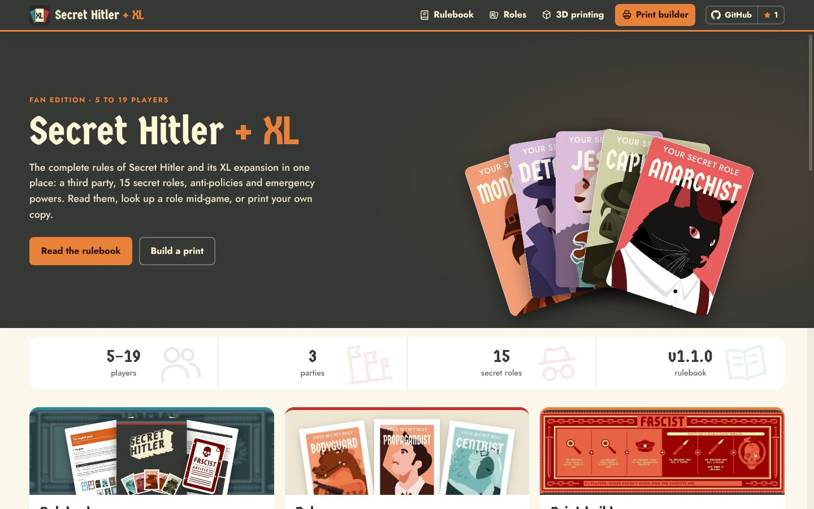
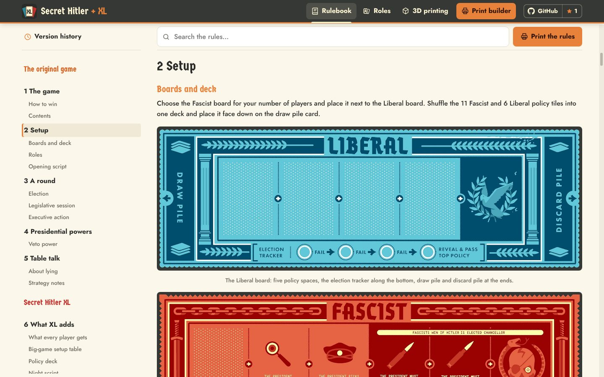
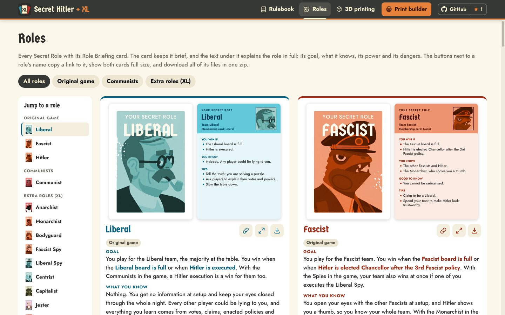
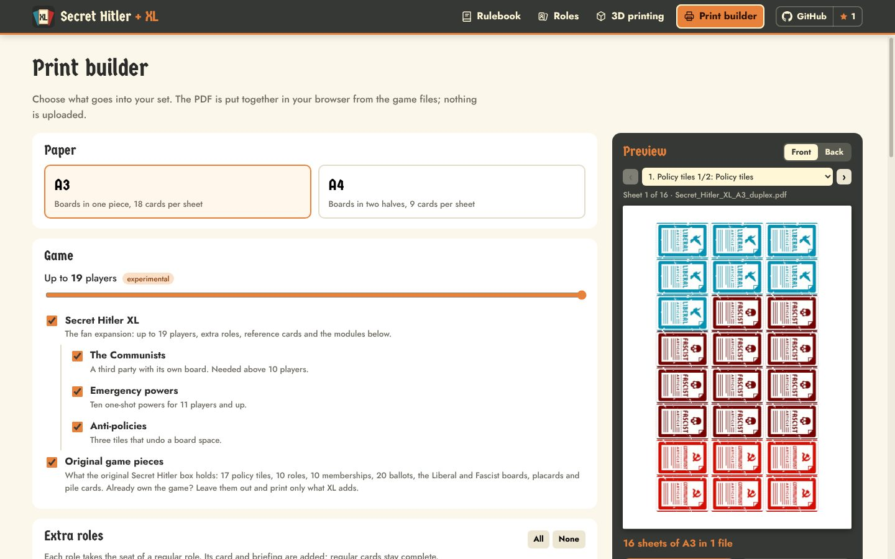
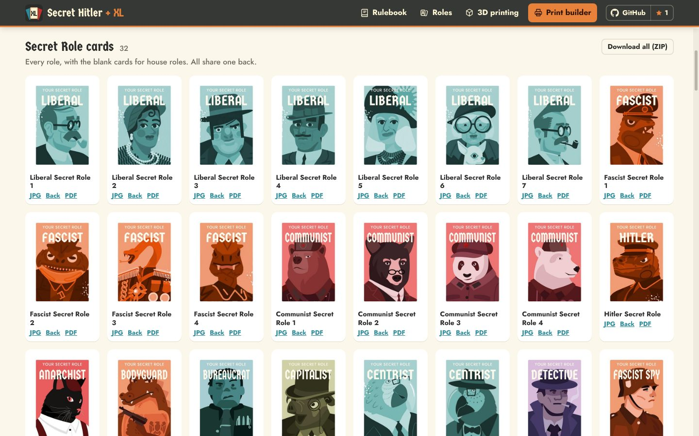

# Secret Hitler + XL

**The complete rules of Secret Hitler and its XL fan expansion, every secret role, and a print builder that makes your own print-and-play copy, in full colour, for 5 to 19 players.**

**Open the site: <https://firestone82.github.io/secret-hitler-xl/>**

## What you can do

### Read the rules

The full rulebook of the original game and the XL expansion on one page, with search and a table of contents. You can also download it as a PDF (A5 or A4, normal or as a folded booklet) or print it straight from the page.

### Look up a role

Every secret role with its Role Briefing card: when it wins, what it knows at the start and tips on how to play it. Handy to check mid-game, or to hand a new player. Each role downloads as one zip with its card art, portrait and print-ready PDFs.

### Print your own copy

Choose the paper (A3 or A4), how many players, which parts of XL you want (the Communists, emergency powers, anti-policies, extra roles) and how many reference cards and spares. The print builder shows every sheet before you download it, and builds the PDFs right in your browser: nothing is uploaded.

- Print at **100 %** (not "fit to page"), **double-sided**, flipping on the **long edge**.
- Cut along the crop marks. Cards are the standard 63.5 × 88 mm, so normal card sleeves fit.
- Using a print shop? Export a ZIP with every piece as its own PDF with bleed, plus a list of how many copies of each.

### Browse every file

The Assets page shows every card, tile, board, placard and reference card in a grid. Open any of them full size, download the picture or the print-ready PDF, or a whole group as one ZIP. The rulebook PDFs are there too.

## What is Secret Hitler XL?

[Secret Hitler](https://www.secrethitler.com/) is a social deduction game for 5 to 10 players: Liberals against Fascists, with Hitler hidden among them. Its makers offer the base game as a free print-and-play on their website.

Secret Hitler XL is a fan expansion that takes it to 19 players:

- **The Communists** join as a third party, with their own board and powers.
- **Extra roles** like the Monarchist, the Jester, the Detective or the Capitalist twist every game.
- **Anti-policies and emergency powers** keep the board moving at big tables.

This edition keeps the rules of the original game exactly as they are. It collects the base game and XL into one rulebook, re-sets the cards and boards in matching colour, and adds role briefings and reference cards.

## Found a mistake?

Spotted a typo, a rules question or a broken card? [Open an issue](https://github.com/Firestone82/secret-hitler-xl/issues). Want to fix it yourself? See [Contributing](docs/contributing.md).

## Credits

- **Secret Hitler** by Mike Boxleiter, Tommy Maranges and Max Temkin, art by Mac Schubert ([secrethitler.com](https://www.secrethitler.com/)).
- **Secret Hitler Socialist expansion** by Dtep, mrkvicka and havosh.
- **Secret Hitler XL** by Lord_Roguy (Bo P.), with art by u/PenguineWithAFez, u/muhaaman, Leo Carlton and Hal Aetus.
- **This edition, the website and the print builder** by Pavel Mikula ([Firestone82](https://github.com/Firestone82)), who put it online and adjusted the cards, boards and sheets for printing.

This is a fan project and is not affiliated with the publishers of Secret Hitler.

## Licence

- The game content (rules, art, cards, boards and PDFs) is [CC BY-NC-SA 4.0](LICENSE-CONTENT.md), like the original game: share and adapt it with credit, but not for money.
- The website code is [MIT](LICENSE).

## For developers

Running the site locally, the data files and how the print builder works are described in [`docs/`](docs/README.md).
